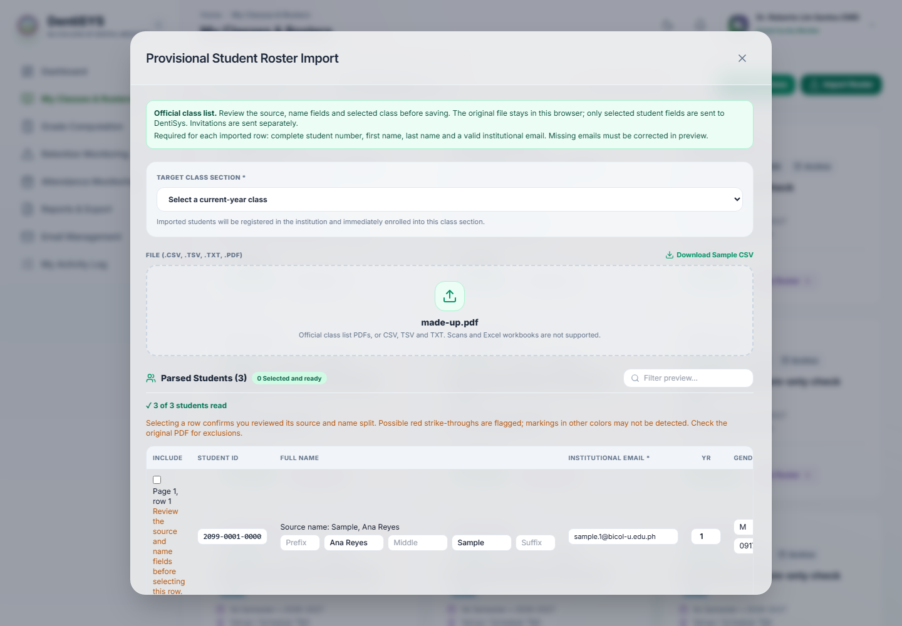
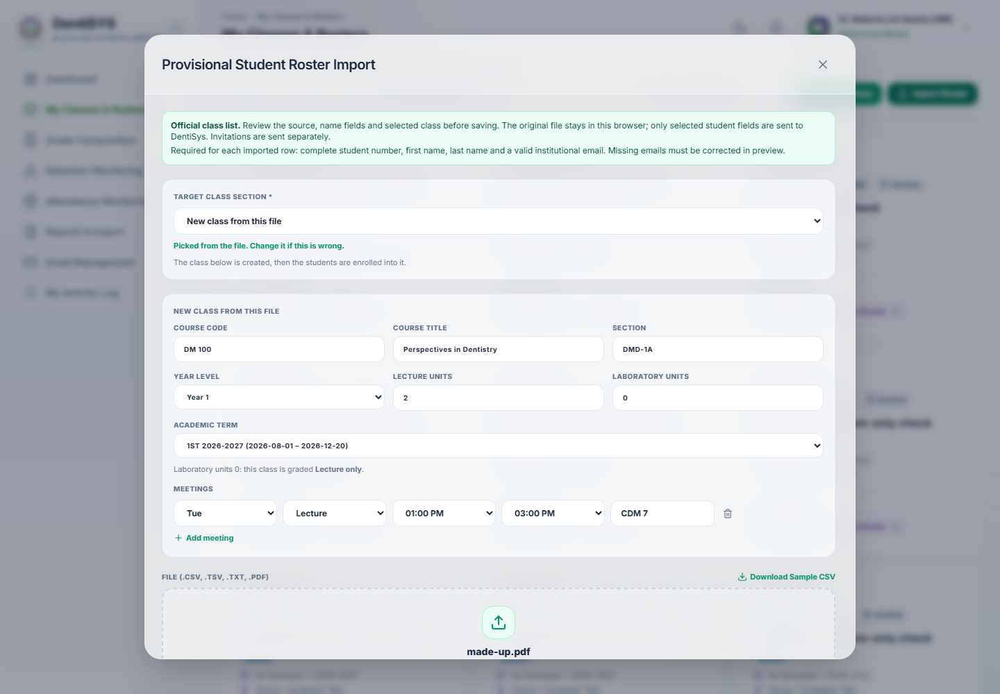

# New class from the class list, October 2026

Importing the Dean's "Official List of Enrolled Students" PDF no longer needs the class to exist first. When no class of the Faculty matches the file, Import Roster offers **"New class from this file"**, prefilled from the PDF header, and creates the class and adds the students in one step. Approved by the Owner on 2026-10-27.

- Contract with every rule and Owner decision: [contracts/class-from-class-list.md](contracts/class-from-class-list.md)
- Clickable Before/After demo (approved): [New Class From the Class List](https://claude.ai/artifact/ADv8U6ptsqt8V8L9u3SYcn)
- Specification: IMP-001, "Owner decision (2026-10-27)", in [spec.md](../spec.md)

## What Faculty see now

**Classes & Rosters → Import Roster.** After an official PDF is read, Step 1 is set from the file: the Faculty's matching class ("This file matches DM 102-DMD-2A. Import into it?") or "New class from this file", with "Picked from the file. Change it if this is wrong." The new-class box holds course code and title, section, year level, Lecture and Laboratory units (Lab units 0 makes a lecture-only class), the Dean term and one meeting row per day from the schedule, all editable. Empty rooms (`---` in the PDF), overlaps and unreadable schedule lines must be fixed or are listed. The button reads "Create class and add N students". If the class is created but adding students fails, the class stays and "Try again" adds them to it. CSV import is unchanged.

| Before | After |
|---|---|
|  |  |

## How it was checked

- `./scripts/check.ps1` passed (new: header and schedule parsing and decision tests in `frontend/src/tests/rosterImport.test.ts`, new-class and match cases in `e2e/roster-import.spec.ts`).
- Live on the local stack: `e2e/live/class-from-class-list.spec.ts` renders a made-up official-layout PDF, creates the class through the dialog and checks via the API that it is lecture-only with its Monday Lecture meeting and 3 enrolled students. A messy schedule (two days on one line, `---` room, Friday overlap, unreadable line) was checked on screen in light, dark and at phone width.
- Real class lists never leave the Owner's PC; tests use made-up files only.

## Release

Frontend only; no migration.
