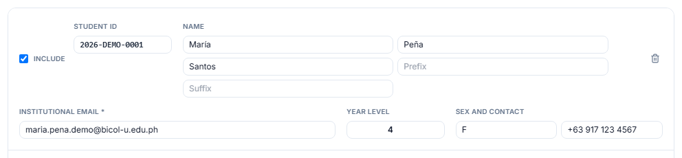
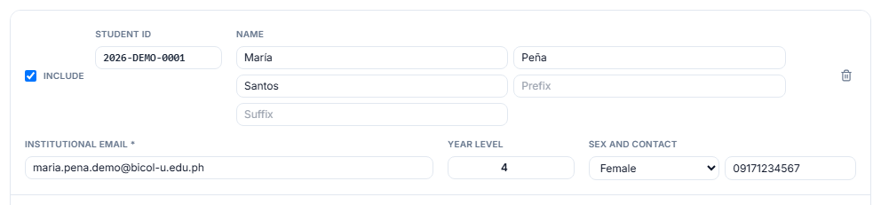
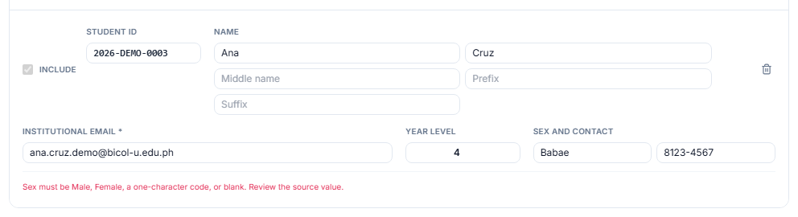
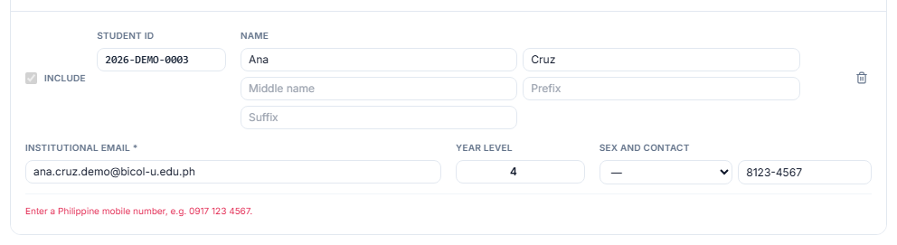
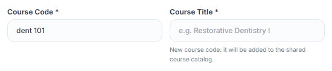
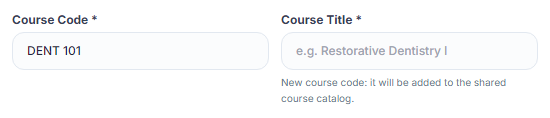

# Field validation and casing, October 2026

An audit of every form field found that names were already checked and capitalized ("NAme" → "Name", ñ allowed), but some fields were not: a name made only of punctuation was accepted, prefix and suffix kept any casing, and contact, sex, student number and class fields took any text. Approved by the Owner on 2026-10-28.

- Clickable Before/After demo (approved): [Field Validation Demo](https://claude.ai/artifact/QwpfWQsHFxkV419ZD7pAfu)
- Specification: the "Owner decision (2026-10-28)" in ID-001 of [spec.md](../spec.md)

## What users see now

**Sex is a Male / Female choice.** In Import Roster the Sex box is a dropdown (—, Male, Female), saved as `M` / `F`. A file value the app does not recognize (for example `Babae`) is left blank for the Faculty to choose instead of blocking the row.

| Before | After |
|---|---|
|  |  |

**Contact must be a Philippine mobile number.** `0917 123 4567`, `0917-123-4567`, `+63 917 123 4567` and `63917…` are accepted and saved as `09171234567`. Anything else (a landline, a typo) blocks the row with "Enter a Philippine mobile number, e.g. 0917 123 4567." Contact stays optional.

| Before | After |
|---|---|
|  |  |

**Course code and block in capitals.** Create Class, Edit Class and Import Roster's new-class step turn `dent 101` / `4-a` into `DENT 101` / `4-A` as you type, and the server does the same. Course titles and rooms only lose extra spaces.

| Before | After |
|---|---|
|  |  |

**Rules seen only on Save.** First, middle and last names need at least one letter. In a prefix or suffix, known words get their usual capitalization (`jr` → `Jr.`, `dr` → `Dr.`, `phd` → `PhD`, `dmd` → `DMD`); other text such as `DMD, MSc` is kept as typed. Student numbers keep any pattern but reject line breaks and control characters.

## How it was checked

- `./scripts/check.ps1` and `./scripts/check-postgres.ps1` passed. New or extended tests: `tests/backend/validation_test.php`, `frontend/src/tests/fieldNormalization.test.ts`, `personNameValidation.test.ts`, `rosterImport.test.ts`.
- Live on the local stack: a three-row roster file (female / `+63 917 123 4567`, `jr` suffix, `Babae` / landline) imported in review on desktop and phone; Create Class typed in lowercase.
- Edit Student never sends sex or contact, so old values never block an edit.

## Release

Adds migration `053_field_normalization.sql` (data only, nothing deleted), so the demo and production deploys must migrate (backup first). It converts sex to `M`/`F`, PH mobile contacts to `09XXXXXXXXX`, and course codes and blocks to uppercase, and prints any students left with another sex or contact value. On the dev database it changed 1 course code and 1 block and left 0 students to review.
