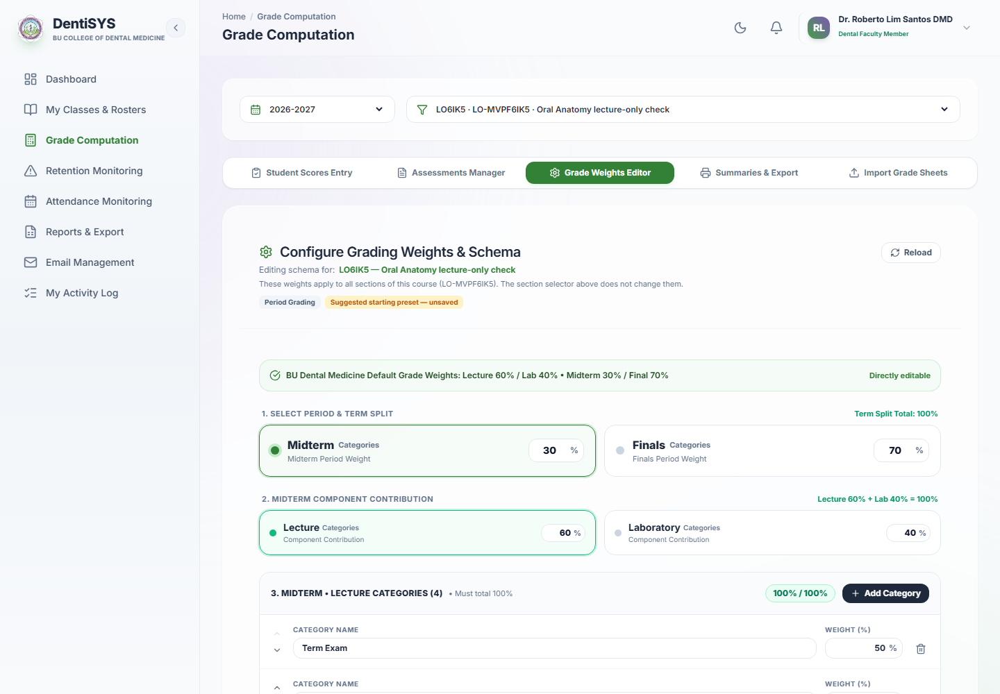
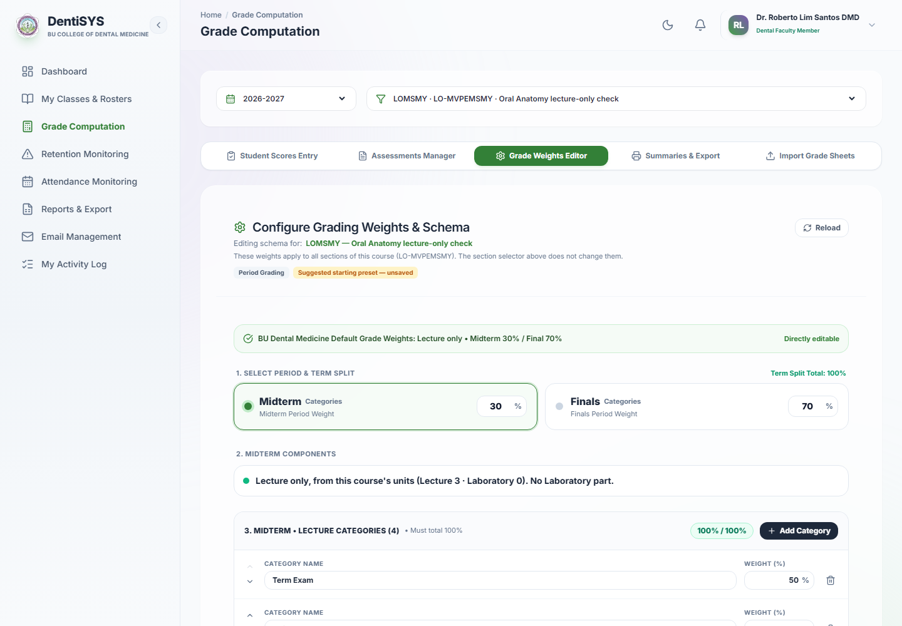
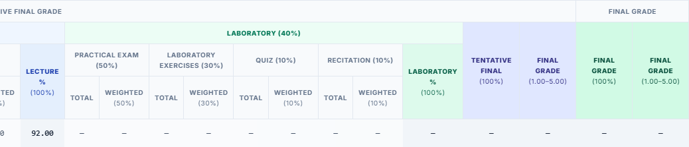
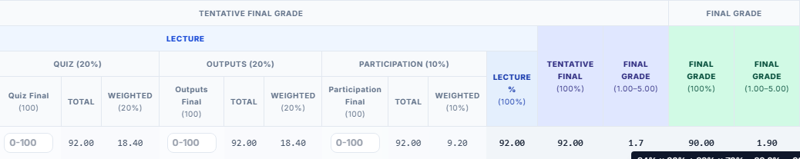

# Lecture-only courses, October 2026

Some BUCDM courses have no Laboratory. DentiSys used to force every course into Lecture + Laboratory grading, so a lecture-only course had an empty Laboratory part worth 40% and every grade stayed Incomplete. Now a course with Lecture units and 0 Laboratory units is graded as Lecture only. Approved by the Owner on 2026-10-26.

- Contract with every rule and Owner decision: [contracts/lecture-only-grading.md](contracts/lecture-only-grading.md)
- Clickable Before/After demo (approved): [Lecture-Only Grading Demo](https://claude.ai/artifact/383CbvDr2AFiJ7iYueyks5)
- Specification: GRD-002 and the "Owner-approved amendment (2026-10-26): Lecture-only courses" in GRD-003 of [spec.md](../spec.md)

## What Faculty see now

**Grade Weights.** For a lecture-only course the banner reads "Lecture only • Midterm 50% / Final 50%", step 2 is one line ("Lecture only, from this course's units …") instead of the Lecture/Laboratory boxes, and each period has one Lecture category list. Courses whose units were never recorded keep Lecture + Laboratory, with a note pointing to Classes & Rosters. When a course's units change, the saved weights keep working until the next save, and a banner says what the save will do.

| Before | After |
|---|---|
|  |  |

**Gradebook and grades.** One "Lecture" group, no Laboratory columns. The course grade is `round(Midterm × 30% + Final × 70%)`, rounded once; hovering it shows e.g. "84% × 30% + 92% × 70% = 89.6% → 90% → 1.9". This rule is **provisional** until it is checked against the Dean's lecture-only sheet (`OA LEC.xlsx`); see contract rule L9. Student grades, Reports and the CSV show no Laboratory line.

| Before | After |
|---|---|
|  |  |

**Other rules.** Removing a course's Laboratory units is refused while any current-year class of that course has Laboratory assessments (the message names the class). A grade sheet's LAB sheet is skipped with a warning for a lecture-only class. Lecture + Laboratory courses and past school years are unchanged.

## How it was checked

- `./scripts/check.ps1` and `./scripts/check-postgres.ps1` passed (new: `tests/backend/lecture_only_grading_test.php`, `tests/database/lecture_only_grading_integration.php`, a mocked lecture-only case in `e2e/faculty.spec.ts`).
- Live on the local stack: a lecture-only class created through the app, Grade Weights saved as Lecture only (Lecture 100%, no Laboratory share), Midterm 84 and Final 92 recomputed to 90 → 1.9, gradebook header and hover checked in light and dark.

## Release

Adds migration `051_lecture_only_grading.sql` (additive constraint change), so the demo and production deploys must migrate (backup first). No grade recalculation is needed: no lecture-only configurations exist yet.
