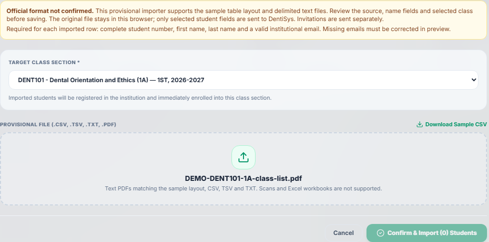
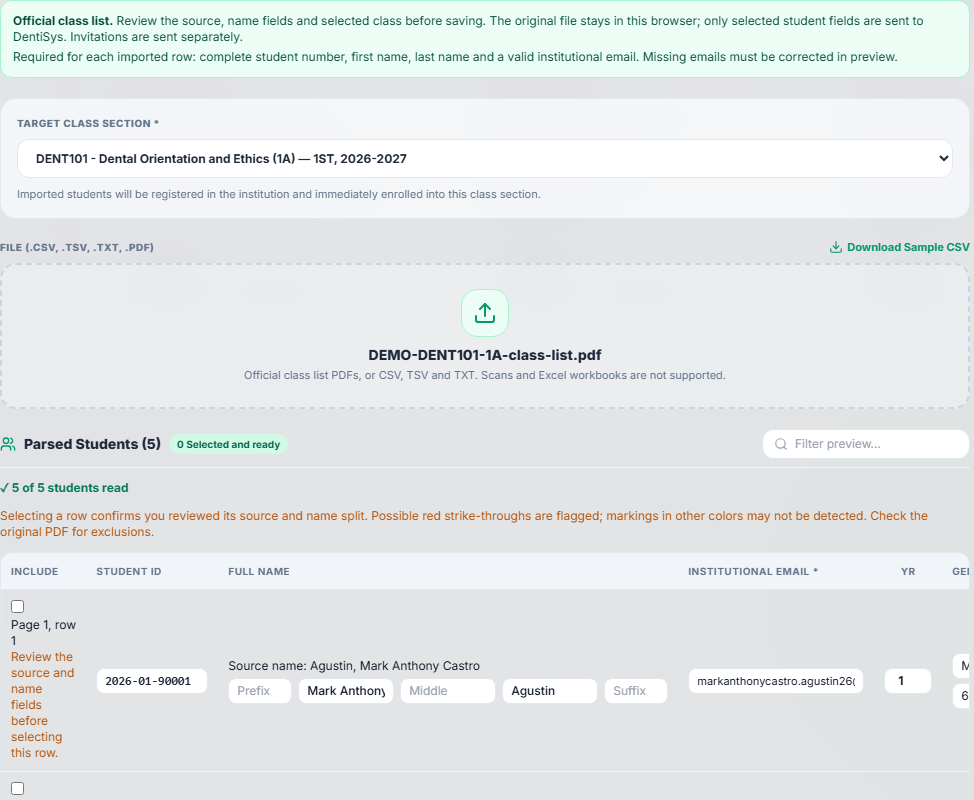
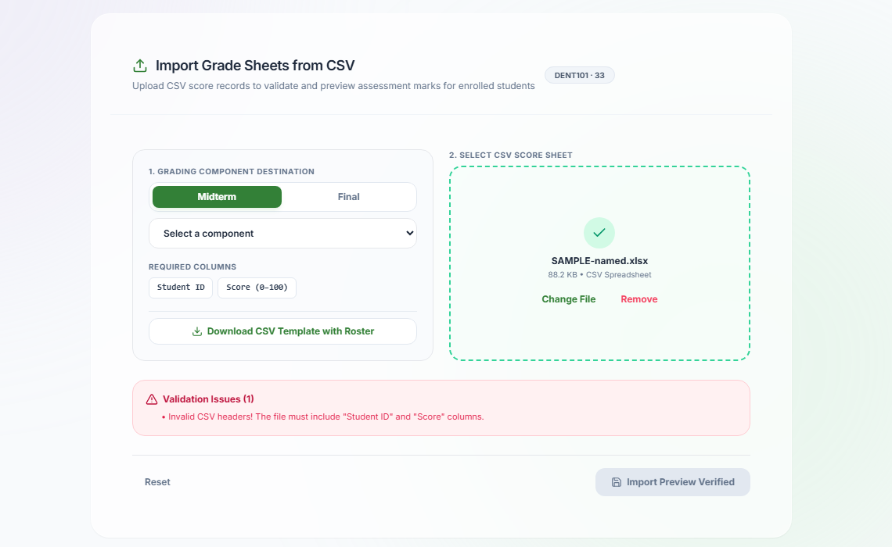
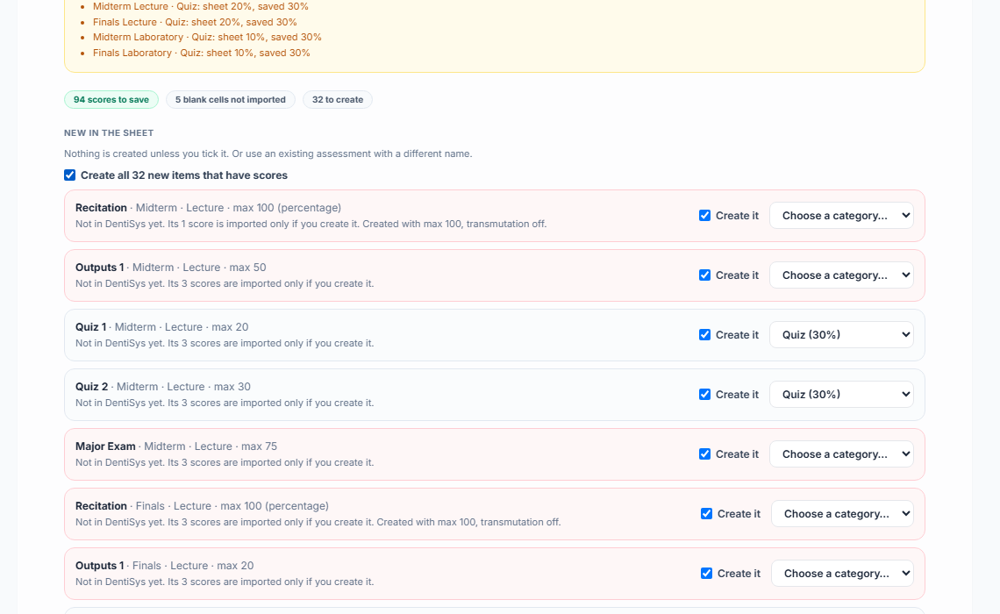

# Official class list and grade sheet imports, October 2026

Faculty now upload the Dean's files exactly as the school gives them: the "Official List of Enrolled Students" PDF and the official grade sheet workbook (.xlsx). DentiSys also calculates grades the way that grade sheet does. Approved by the Owner on 2026-10-26.

- Contract with every rule and Owner decision: [contracts/official-imports.md](contracts/official-imports.md)
- Clickable Before/After demo (approved): [Official Imports Demo](https://claude.ai/artifact/2qfYUM9W8C5xL5PnGWTuBm)
- Specification: IMP-001 and the "Owner-approved amendment (2026-10-26): Official BUCDM grade sheet calculation" in [spec.md](../spec.md)

## What Faculty see now

**Class list (Classes & Rosters → Import Roster).** The official PDF loads in full: the Program column no longer ends up in first names, a last page holding only "Total Number of Students" is accepted, the rows read are checked against that total, "No University Email" rows wait for an email, and a file whose course, section, school year or semester differs from the chosen class shows a warning. The box reads "Official class list"; the CSV template keeps "Official format not confirmed".

| Before | After |
|---|---|
|  |  |

**Grade sheet (Grade Computation → Import Grade Sheets).** The old "Student ID, Score" CSV preview is replaced. The workbook's Lecture and Laboratory sheets are read in the browser; only raw scores are imported. Students are matched by name; new, missing and differently sized quizzes and exams are only created, linked or removed when Faculty tick them ("Create all" ticks every new item with scores); changed scores show old → new; one "Import scores" click saves everything or nothing, shown as one audit row "Imported grade sheet · N changes · class".

| Before | After |
|---|---|
|  |  |

Screenshots: real local app with made-up data only (a generated PDF in the official layout and a copy of the anonymised sample workbook with seeded names).

**Grades everywhere (option B).** A category is the plain average of its items; period and course grades are rounded to whole percents (.5 up) as the Dean's sheet does; below 75% is 5.0 for Midterm too. Hovering a grade shows its steps, e.g. "83.77% → 84% → 2.5". The Gradebook category total reads "x of 100". Missing scores still keep a grade incomplete.

## Release step

Every current-term grade is recalculated once with the new rules: `backend/bin/recompute-current-grades.php preview|apply`. It keeps manual retention overrides and sends no student notifications (Owner, 2026-10-26). On the demo: `./scripts/demo-vps.ps1 recompute-grades preview`, Owner sees the list, then `apply`. `promote-prod.ps1` runs `apply` after its deploy. See the [release guide](release-guide.md).

## Owner rulings

- The Dean's files are official; DentiSys adapts to them and never asks Faculty to change a file.
- Option B grade math for every class; the course grade follows the summary (TFG) sheet: round(round(Midterm × share) + round(Final × share)). Lecture-only courses are a later version (ask the Dean which rounding the Lecture tab should use).
- Risk levels stay retired (2026-10-17); the rule mistakenly added on 2026-10-26 was removed.
- `.xlsx` only, up to 10 MB; password-protected workbooks get a clear message.
- Exports in the Dean's layout are the next, separate feature.

## How it was checked

- `./scripts/check.ps1`: frontend build, 170 unit tests, backend tests, 241 browser tests (rerun with 2 workers after the test server ran out of memory).
- `./scripts/check-postgres.ps1`: PostgreSQL integration suite (import save, grade math, raw values kept as proof) and the live browser suite.
- Golden test from the Dean's sample: student 1 → Midterm 82, Final 88, course 87 → 2.2, the same as the TFG sheet.
- The four real class list PDFs (not kept in the repo) read 40, 38, 41 and 45 students with clean names.

## Lessons

- The sample workbook rounds the course grade two ways (Lecture tab vs Lab/TFG tabs); check a formula in every tab, not just one.
- A name matcher must not rely on separate first/last fields; the app often passes only the full name.
- `docker compose build` does not refresh the named `frontend_node_modules` volume; run `npm ci` in the container after adding a dependency.
