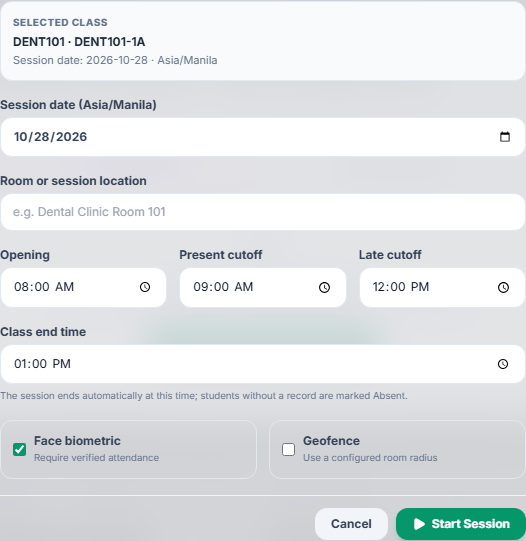
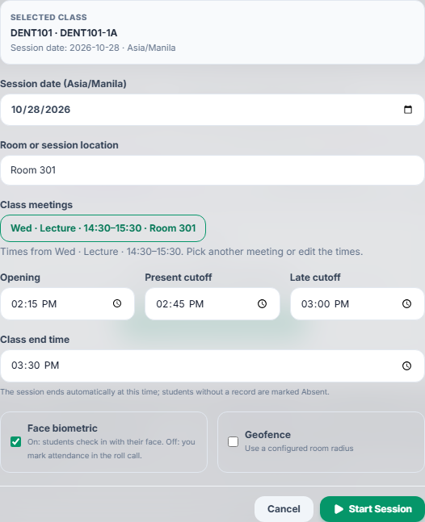
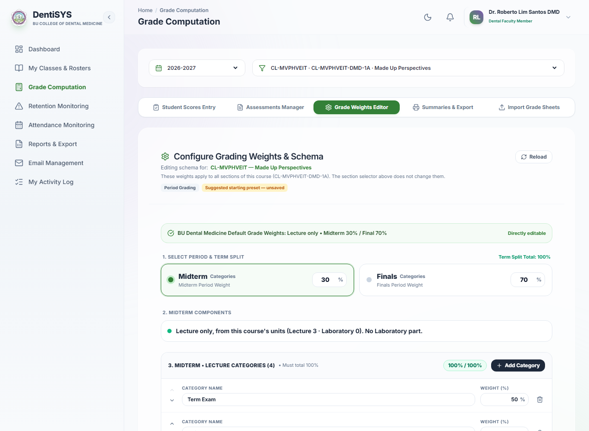
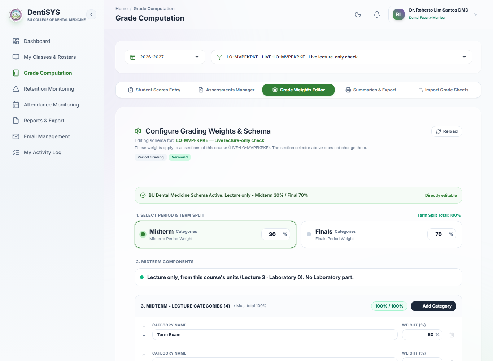

# Start Session defaults and small fixes, October 2026

Start Session now takes its times from the class schedule instead of always opening at 08:00–13:00. Two reported bugs are fixed in the same release. Approved by the Owner on 2026-10-27.

- Contract with every rule and Owner decision: [contracts/session-default-times.md](contracts/session-default-times.md)
- Clickable Before/After demo (approved): [Start Session Defaults](https://claude.ai/artifact/CLSA9CJUhqkhLHKumWfwuE)
- Specification: no change (the spec has no rule about these defaults).

## What Faculty and Secretaries see now

**Start Session.** The form picks today's class meeting that is under way, or the next one today, and fills Opening (start − 15 min), Present cutoff (+15), Late cutoff (+30), Class end (meeting end) and the room. The class's meetings are listed as chips ("Mon · Lecture · 09:00–11:00 · CDM 1"); a click refills the times and room, never the date. With no meeting today the old 08:00 / 09:00 / 12:00 / 13:00 stays. The Face biometric switch now explains itself: "On: students check in with their face. Off: you mark attendance in the roll call." (Start and edit forms.)

| Before | After |
|---|---|
|  |  |

**Archived classes are view-only everywhere** (bug found by the live tests; contract [archived-class-views.md](contracts/archived-class-views.md), spec CLS-002/CLS-003). A class archived this school year used to act as a current class outside Classes & Rosters: Grade Computation could open on it and every change was refused ("Archived classes are view-only"), Attendance and Import Roster offered it. Now the default class is the first active one; classes archived as Finished are listed after the active ones as "(Archived · view only)" in Grade Computation and with an "Archived" badge and View Attendance only in Attendance; Cancelled and Created-by-mistake classes are not listed; Import Roster offers only active classes. Settings and the Dashboard use the same rule.

| Before | After |
|---|---|
|  |  |

**Geofence radius** (reported bug): typing "01000" now shows "1000", an emptied box stays empty, and saving outside 50–2000 m is blocked with "Allowed radius must be between 50 and 2000 meters." (Start and edit forms.)

**Authenticator setup** (reported bug): first-time users installing an authenticator app took longer than the 5-minute setup and saw "Authentication failed. Please log in again." Setup now lasts 10 minutes, an expired setup says "This setup expired. Click Set up again to get a new QR code.", and a double click on Set up starts only one setup. Sign-in 2FA is unchanged.

## Attendance report (2026-10-27)

A user reported the attendance flow not working, without details. Replayed on the demo site: starting, scheduling and ending sessions, the student's session list, face registration up to the camera step, the Faculty roll call, manual Present override (shown in the student's log) and the Secretary page all worked. The face match itself needs a real phone test. The likeliest real-world cause was the fixed 08:00–13:00 defaults (a session started outside those hours was scheduled for 08:00 or had already ended), which this release fixes.

## How it was checked

- `./scripts/check.ps1` and `./scripts/check-postgres.ps1` passed (new: `frontend/src/tests/sessionDefaults.test.ts`, `frontend/src/tests/geofenceRadiusAndMfaSetup.test.ts`, `frontend/src/tests/classArchivingViews.test.ts`, mocked Faculty and Secretary Start Session cases, the radius case, Grade Computation and Attendance archived-class cases, MFA backend checks; 15/15 live browser tests).
- The live specs `lecture-only.spec.ts` and `class-from-class-list.spec.ts` now archive their test classes when they finish, and the older live tests skip archived classes, so the specs no longer affect each other.
- The real Start Session form was checked at Monday 08:40 and Wednesday 14:20 Manila, and an archived class on Grade Computation and Attendance, in light and dark.

## Release

No migration. The Secretary dashboard API (`/api/secretary/dashboard/kpis`) gains an additive `meetings` list per assigned class.
